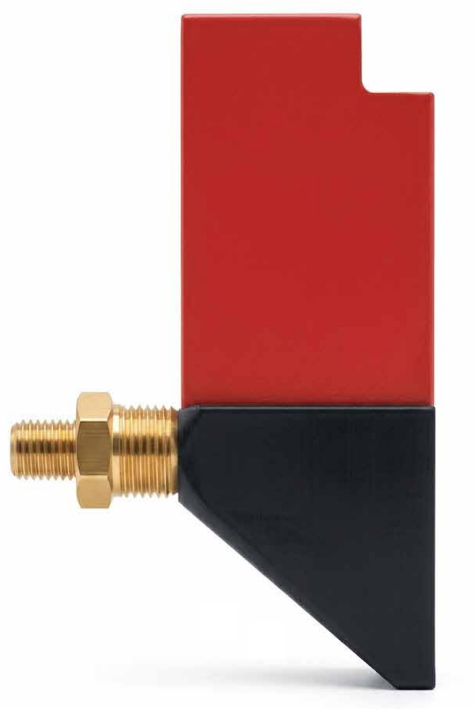
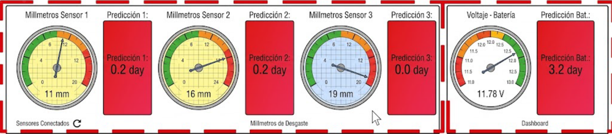
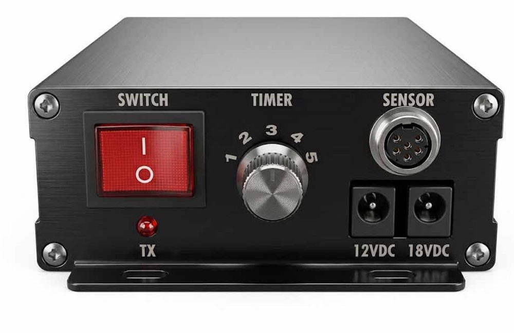
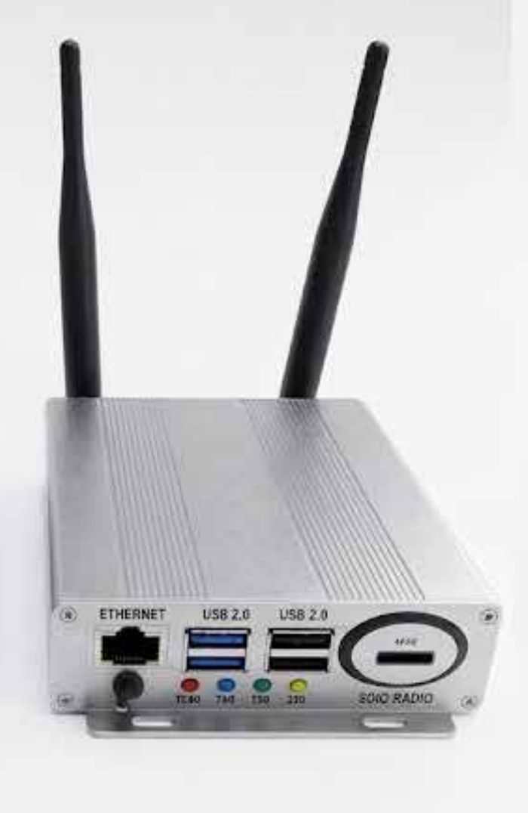
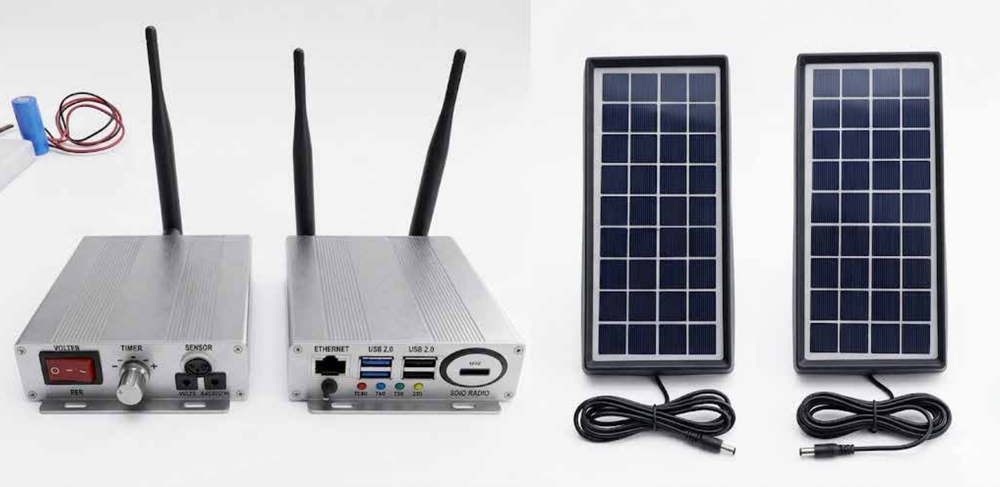
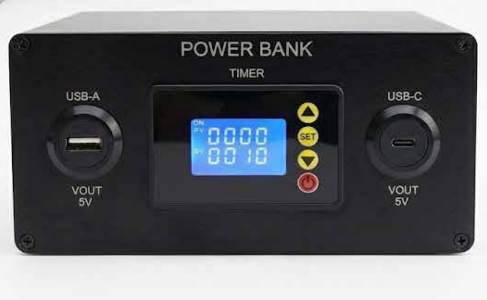
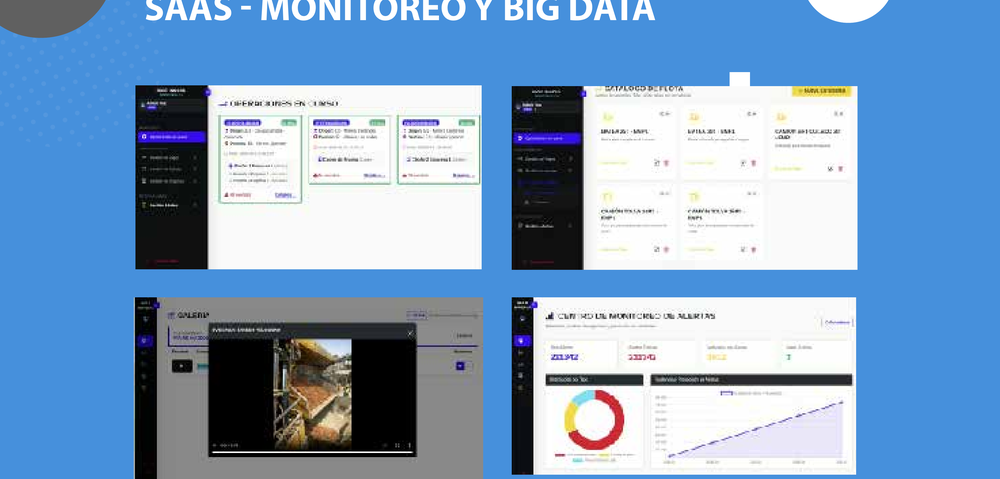
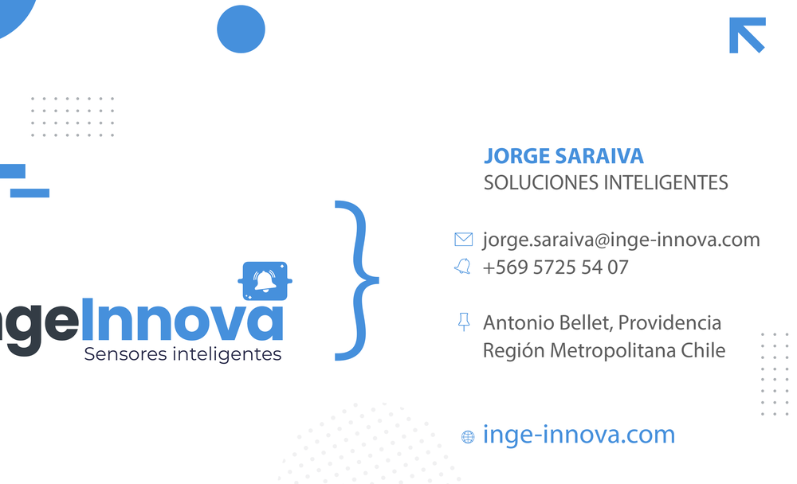

# Jorge Luis Saraiva Ruas

**Software & Electronic Engineer · Sensores inteligentes, agentes de IA, ciberseguridad y sistemas web · Chile**

Stack: PHP · TypeScript · React · Node.js · Python · Rust · C# / .NET · Oracle · MySQL · PostgreSQL

## Lo que hago
Combino tres disciplinas: **ingeniería en sistemas, ingeniería electrónica e inteligencia artificial**. En [Inge Innova](https://inge-innova.com) diseño soluciones completas de **sensor + transmisor + aplicación SaaS** para industria y minería, y desarrollo software a medida para empresas chilenas.

## Sensores inteligentes (industria y minería)
*Imágenes de los dispositivos y de la plataforma. Haz clic en una para verla en tamaño completo.*

Cada solución es **sensor + transmisor + plataforma SaaS** y comparte:
- **Transmisión en terreno a 433 MHz**, desde la faena hasta la puerta de enlace (gateway), con alcance de hasta **32 km en línea de vista**.
- **Propiedad intelectual:** todos los sensores y sistemas están **patentados** y protegidos por derechos de propiedad intelectual.
- **Energía autónoma:** baterías con duración de hasta **3 años**, según la tasa de envío de datos, y el mismo modelo de energía y conectividad en toda la línea de sensores.
- **Integración con sala de control** por protocolo **Modbus**, con gráficos en tiempo real.
- **Predicción de mantenibilidad con 99% de precisión** en la fecha de la próxima mantención, usando **Random Forest**, **regresión lineal** y **agentes de IA**.

### Smarter Sense Wear: sensores de desgaste de revestimientos (creado en 2020)
- **Sensor:** mide **milímetro a milímetro** directamente en el cuerpo de desgaste del revestimiento y notifica por **alerta temprana** a los responsables de mantención, en tiempo real y desde varios equipos y ubicaciones.
- **Transmisor ING:** temporizador, switch, LED de transmisión, conector de sensor de 6 pines, alimentación de 12 V y 18 V, conector SMA y antena omnipolar.
- **Receptor ING (gateway):** antenas omnipolares a 433 MHz, puertos USB 2.0 y 3.0, Ethernet para conexión directa a internet, módem 3G y 4G, alimentación USB-C de 5 V 3 A e indicadores LED de encendido, transmisión y recepción.
- **Energía y conectividad 24/7:** hardware de alta calidad y sustentable, con paneles solares y power bank con temporizador.
- **Plataforma SaaS:** indicadores de milímetros por sensor con predicción en días, voltaje de batería con su predicción, gráficos de líneas y de barras, módulo para cambiar de panel (hasta 5 transmisores) e informes automáticos en PDF y Excel por correo, con historial de desgaste.

|   |   |   |
|:-:|:-:|:-:|
|  Faena, gateway y sala de control |  Sensor de desgaste |  Indicadores de mm y predicción en días |
|  Desgaste por sensor y proyección |  Tendencia de desgaste |  Transmisor ING |
|  Receptor ING (gateway) |  Hardware con energía solar |  Power bank con temporizador |

### Truck Smarter Tracker: telemetría, seguridad y SaaS para flotas de camiones (creado en 2021)
Control de seguridad y monitoreo para flotas de camiones de alto nivel.
- **Sensores:** presión hidráulica con monitoreo continuo hasta 250 bar, peso de carga para evitar sobrecargas, inclinación en tiempo real y velocidad con alertas automáticas por excesos, más GPS para geolocalización.
- **Seguridad total con 5 cámaras IP de alta definición (cobertura 360°):** frontal, trasera, dos laterales y una de carga, con transmisión en tiempo real y sincronización a la nube; se ven desde celular, tablet o panel central.
- **Evidencias y alertas:** log inteligente de notificaciones clasificadas por severidad con alertas push, galería multimedia automática que graba video ante eventos críticos (excesos de velocidad, frenados bruscos) etiquetado con fecha, hora, vehículo y tipo de incidente, y trazabilidad completa de cada viaje.
- **Gestión de despacho:** ciclos de transporte y eficiencia por vehículo, mapa de rutas activas en tiempo real y estado de viaje (carga, tránsito, descarga y disponible).
- **Energía y conectividad:** mismo modelo que Smarter Sense Wear, con baterías de hasta 3 años de duración según la tasa de envío.
- **Conectividad total:** sensores y cámaras envían datos encriptados a un gateway IP que los transmite a la nube, con acceso 24/7 desde móvil, tablet y escritorio.
- **Instalación completa y acceso al SaaS:** diagnóstico inicial, instalación certificada, activación del SaaS y capacitación con soporte 24/7 durante la vigencia del contrato.

|   |   |   |
|:-:|:-:|:-:|
|  Conectividad: sensores, gateway, nube y SaaS |  Instalación y acceso al SaaS |   |

### Smarter Pressure: control de tonelaje en chancado (creado en 2023)
Automatización del control de tonelaje en chancado, con la plataforma SaaS que documenta, monitorea, alerta y protege.
- **Estación de pesaje N6X:** estructura robusta en acero A36 para las condiciones extremas del área de chancado, con celdas de carga integradas en la viga principal que registran con alta precisión la masa del material sobre los rodillos de transporte.
- **Sensor de velocidad N60:** monitoreo continuo del desplazamiento de la correa y datos en milisegundos para calcular con exactitud el flujo dinámico, con montaje seguro en puntos de anclaje fijos.
- **Integrador de pesaje (serie 6101):** es el cerebro del sistema; recibe las señales de las celdas de carga y del sensor de velocidad, calcula el caudal en tiempo real y controla el variador de frecuencia (VFD), con panel de membrana y puerto de comunicaciones para integrarse a la planta.
- **Plataforma SaaS:** control por meta diaria, producción real y proyección a 6 meses, con evidencias y alertas en línea.

|   |   |   |
|:-:|:-:|:-:|
|  Panel SaaS de tonelaje |  Estación de pesaje N6X |  Integrador de pesaje (serie 6101) |
|  Sensor de velocidad N60 |   |   |

### Almacenamiento de líquidos y control de fugas (creado en 2024)
Sensores para el almacenamiento de líquidos, el control de fugas y las emergencias.
- **Monitoreo 24/7 de la carga** de tanques de agua y otros líquidos, con gráficos de nivel en tiempo real.
- **Alertas de emergencia** por desabastecimiento, con aviso crítico cuando la reserva baja de un umbral.
- **Control de usuarios y usos:** flujo de personas y consumo por sector.
- **Inteligencia artificial** para el ahorro energético.
- **Plataforma SaaS** para reportes y análisis, con exportación de informes.

|   |   |   |
|:-:|:-:|:-:|
|  Tanques: estado normal |  Tanques: alerta crítica |   |

## Ciberseguridad
- **[Sentinel HIDS](https://github.com/saraivaruas/sentinel-hids):** detector de intrusiones para Linux, de código abierto: integridad de archivos, webshells, fuerza bruta, escaneo de puertos, honeypots y panel gráfico, en Python sin dependencias.
- **Auditoría de red y sistemas:** revisión de puertos, servicios, firewall y accesos SSH.
- **Hardening de servidores Linux** y monitoreo de integridad.

## Plataformas web en producción
- **[PROJEX](https://projects.inge-innova.com):** gestión de proyectos para empresas de servicios: clientes, cotizaciones, proyectos, facturación electrónica al SII, horas y calendario, con portal de cliente y asistente de IA.
- **[LICITEX](https://licitaciones.inge-innova.com):** gestión inteligente de licitaciones públicas en Chile, postulaciones, logisticas y busquedas de proveedores automaticas con agentes de IA.
- **[DATAHUB](https://hub-data.inge-innova.com):** plataforma de datos y análisis comercial (acceso con cuenta).
- **[INVENTEX](https://inventario.inge-innova.com):** activos fijos, bodega, kardex, bajas, depreciación e inventario físico para municipalidades.
- **[TRASLADEX](https://trasladopremium.cl):** reserva de traslados premium de pasajeros.
- **[SECUREX](https://chat.inge-innova.com):** chat con cifrado de extremo a extremo, notificaciones push y mensajes que se autodestruyen.
- **[WA-CRMEX](https://crm.inge-innova.com):** CRM integrado con WhatsApp.

## Otros proyectos de software
- **Hub BI:** informes tipo Power BI (ASP.NET Core 8, React, Apache ECharts, MySQL).
- **Mapa comercial:** información comercial sobre mapas, con foco en fiscalización e inversión inteligente.
- **MediPocket:** catálogo de medicamentos por familias, para salud y público general.
- **Programa de hormigón:** gestión de producción de hormigón.
- **Plataformas de turismo:** sitios y CRM para alojamiento y experiencias.
- **Servidor de licencias:** control de licencias de mis productos.
- **Separador musical:** separa una canción por instrumento y la transcribe a MIDI y partitura (Python).

## Proyectos open source
- **[dte-chile](https://github.com/saraivaruas/dte-chile):** facturación electrónica al SII (PHP y C#/.NET), con versiones [PHP](https://github.com/saraivaruas/dte-chile-php) y [.NET](https://github.com/saraivaruas/dte-chile-dotnet).
- **[mercado-publico-api](https://github.com/saraivaruas/mercado-publico-api):** cliente de la API de Mercado Público (ChileCompra) en PHP, C# y Rust.
- **[elegibilidad-fondos](https://github.com/saraivaruas/elegibilidad-fondos):** motor determinista de elegibilidad para 29 programas de fomento en Chile.
- **[sentinel-hids](https://github.com/saraivaruas/sentinel-hids):** detector de intrusiones para Linux, en Python sin dependencias.

## Paquetes en NuGet
- **[DteChile](https://www.nuget.org/packages/DteChile):** genera, timbra, firma y envía DTE al SII de Chile (.NET, sin dependencias).
- **[MercadoPublico](https://www.nuget.org/packages/MercadoPublico):** cliente de la API de Mercado Público (ChileCompra) para .NET.

## Asesoría y servicios
Trabajo con empresas e instituciones en Chile a través de [Inge Innova](https://inge-innova.com), con esta metodología: **diseño y desarrollo**, **implementación y capacitación**, **gestión y mantenimiento**, y **auditoría y diagnóstico**.
- **Ciberseguridad:** auditoría de red y sistemas, hardening de servidores Linux, detección de intrusiones y monitoreo de integridad.
- **Sensores inteligentes a medida:** diseño de sensor, transmisor y plataforma SaaS, con instalación certificada, capacitación y soporte durante la vigencia del contrato.
- **Software a medida:** plataformas web, integraciones con el SII y Mercado Público, y paneles de datos.
- **IA aplicada:** agentes de IA y modelos de predicción de mantenibilidad.

¿Tienes un proyecto o un problema por resolver? Escríbeme a jorge.saraiva@inge-innova.com o visita [inge-innova.com](https://inge-innova.com).

## Contacto
- Web: [inge-innova.com](https://inge-innova.com)
- NuGet: [jorgesaraivaruas](https://www.nuget.org/profiles/jorgesaraivaruas)
- Correo: jorge.saraiva@inge-innova.com
