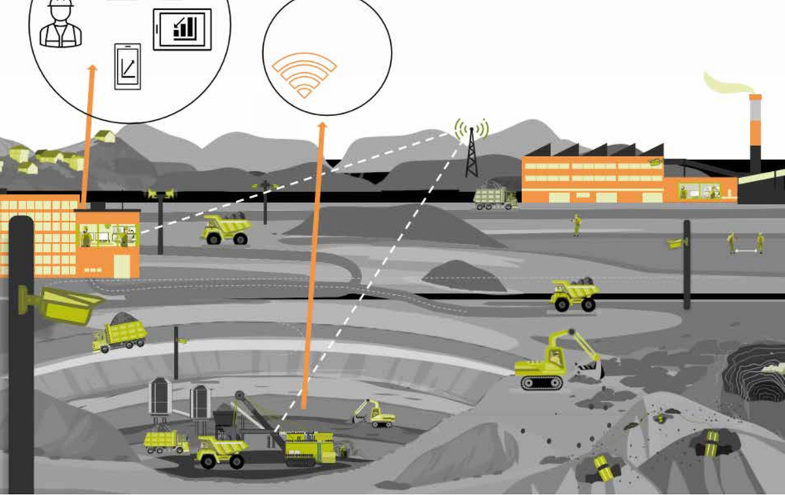
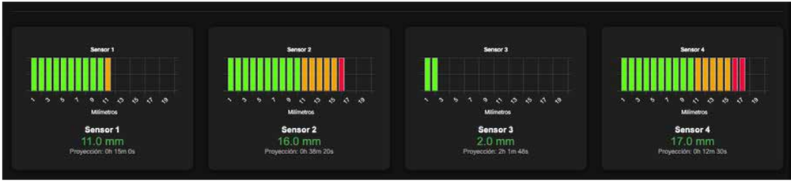
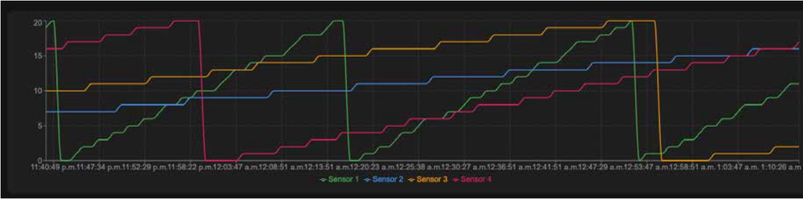
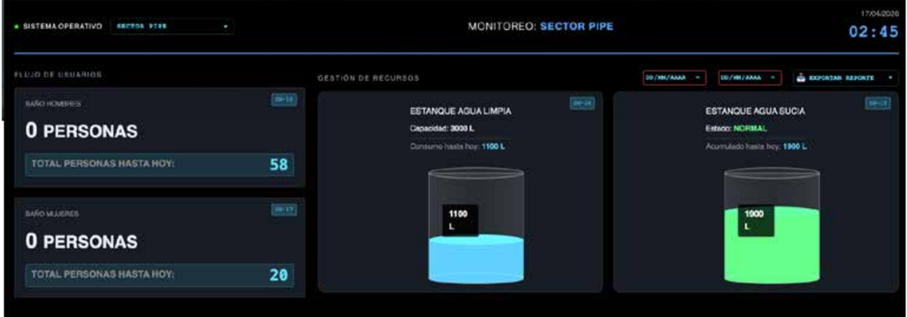
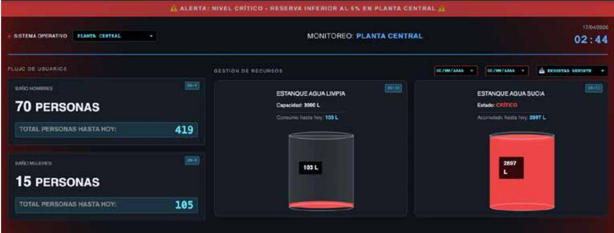
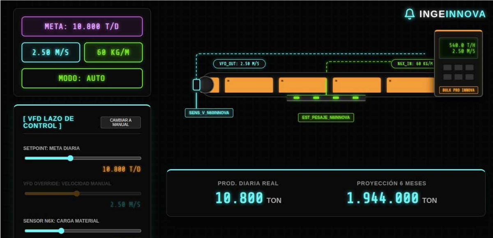
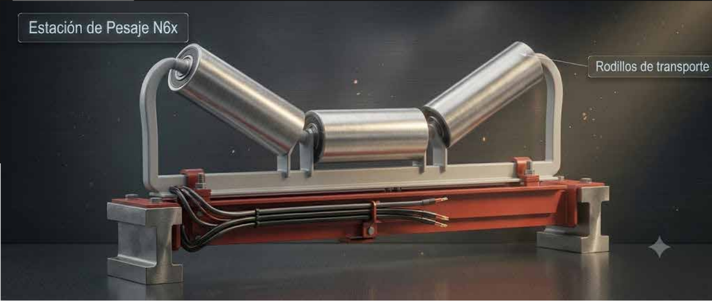
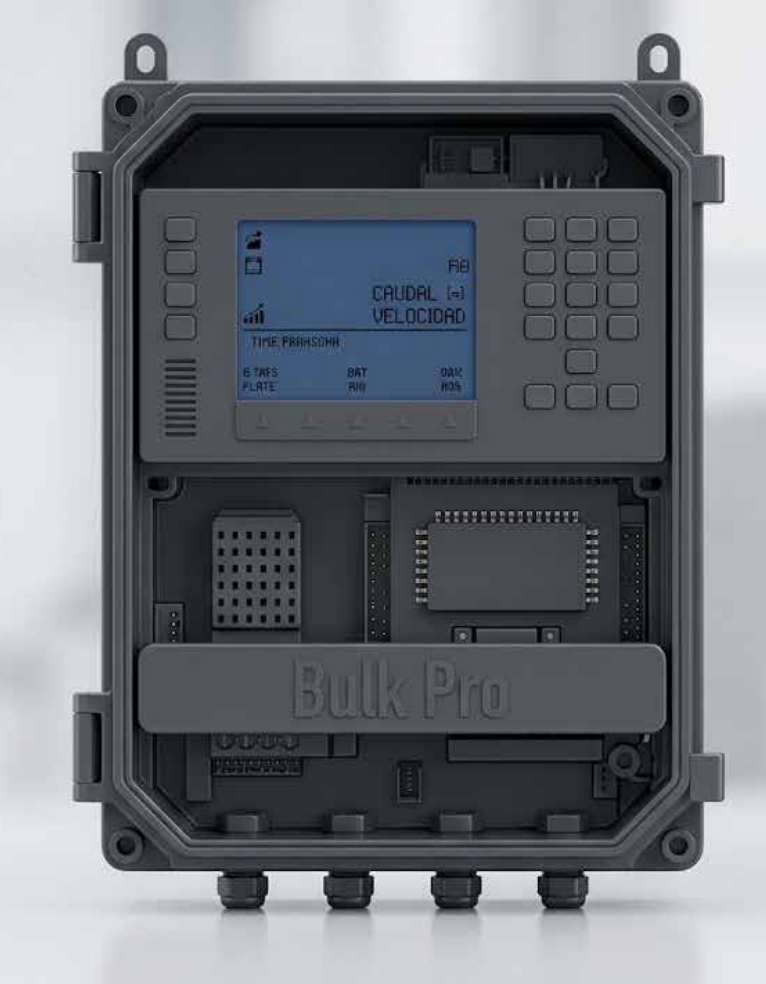
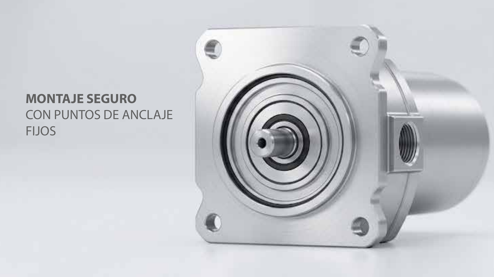

# Jorge Luis Saraiva Ruas

**Software & Electronic Engineer · Sensores inteligentes, agentes de IA y sistemas web · Chile**

Stack: PHP · TypeScript · React · Node.js · Python · Rust · C# / .NET · Oracle · MySQL · PostgreSQL

## Lo que hago
Combino tres disciplinas: **ingeniería en sistemas, ingeniería electrónica e inteligencia artificial**. En [Inge Innova](https://inge-innova.com) diseño soluciones completas de **sensor + transmisor + aplicación SaaS** para industria y minería, y desarrollo software a medida para empresas chilenas.

## Sensores inteligentes (industria y minería)
Cada solución es **sensor + transmisor + plataforma SaaS** y comparte:
- **Transmisión en terreno a 433 MHz**, desde la faena hasta la puerta de enlace (gateway), con alcance de hasta **32 km en línea de vista**.
- **Integración con sala de control** por protocolo **Modbus**, con gráficos en tiempo real.
- **Predicción de mantenibilidad con 98% de precisión**, usando **Random Forest**, **regresión lineal** y **agentes de IA**.

Soluciones:
- **Control de desgaste de revestimientos:** medición en **milímetros** (mm a mm) con transmisor autónomo 24/7; los modelos predicen cuándo cambiar el revestimiento y envían alertas push.
- **Seguridad y monitoreo de flotas de camiones:** sensores de presión hidráulica, peso en carga, inclinación y velocidad, GPS y cámaras IP; anticipan fallas y entregan evidencia y alertas en el panel SaaS.
- **Almacenamiento de líquidos y control de fugas:** monitoreo 24/7 de tanques con gráficos de nivel, alertas de desabastecimiento y emergencias, y IA para ahorro energético.
- **Control de tonelaje en chancado:** estación de pesaje N6X con celdas de carga, sensor de velocidad N60 e integrador de pesaje; calcula el flujo en tiempo real y controla el variador de frecuencia (VFD) desde la sala de control.

### Imágenes de las soluciones
*Imágenes referenciales con datos de ejemplo. Haz clic para ver en tamaño completo.*

|   |   |   |
|:-:|:-:|:-:|
|  Faena, gateway y sala de control |  Desgaste por sensor y proyección |  Tendencia y predicción de cambio |
|  Tanques: estado normal |  Tanques: alerta crítica |  Control de tonelaje en chancado |
|  Estación de pesaje N6X |  Integrador de pesaje (serie 6101) |  Sensor de velocidad N60 |

## Plataformas web en producción
- **[PROJEX](https://projects.inge-innova.com):** gestión de proyectos para empresas de servicios: clientes, cotizaciones, proyectos, facturación electrónica al SII, horas y calendario, con portal de cliente y asistente de IA.
- **[LICITEX](https://licitaciones.inge-innova.com):** gestión inteligente de licitaciones públicas en Chile, postulaciones, logisticas y busquedas de proveedores automaticas con agentes de IA.
- **[DATAHUB](https://hub-data.inge-innova.com):** plataforma de datos y análisis comercial (acceso con cuenta).
- **[INVENTEX](https://inventario.inge-innova.com):** activos fijos, bodega, kardex, bajas, depreciación e inventario físico para municipalidades.
- **[TRASLADEX](https://trasladopremium.cl):** reserva de traslados premium de pasajeros.
- **[SECUREX](https://chat.inge-innova.com):** chat con cifrado de extremo a extremo, notificaciones push y mensajes que se autodestruyen.
- **[WA-CRMEX](https://crm.inge-innova.com):** CRM integrado con WhatsApp.

## Otros proyectos de software
- **Hub BI:** informes tipo Power BI (ASP.NET Core 8, React, Apache ECharts, MySQL).
- **Mapa comercial:** información comercial sobre mapas, con foco en fiscalización e inversión inteligente.
- **MediPocket:** catálogo de medicamentos por familias, para salud y público general.
- **Programa de hormigón:** gestión de producción de hormigón.
- **Plataformas de turismo:** sitios y CRM para alojamiento y experiencias.
- **Servidor de licencias:** control de licencias de mis productos.
- **Separador musical:** separa una canción por instrumento y la transcribe a MIDI y partitura (Python).

## Proyectos open source
- **[dte-chile](https://github.com/saraivaruas/dte-chile):** facturación electrónica al SII (PHP y C#/.NET), con versiones [PHP](https://github.com/saraivaruas/dte-chile-php) y [.NET](https://github.com/saraivaruas/dte-chile-dotnet).
- **[mercado-publico-api](https://github.com/saraivaruas/mercado-publico-api):** cliente de la API de Mercado Público (ChileCompra) en PHP, C# y Rust.
- **[elegibilidad-fondos](https://github.com/saraivaruas/elegibilidad-fondos):** motor determinista de elegibilidad para 29 programas de fomento en Chile.
- **[sentinel-hids](https://github.com/saraivaruas/sentinel-hids):** detector de intrusiones para Linux, en Python sin dependencias.

## Paquetes en NuGet
- **[DteChile](https://www.nuget.org/packages/DteChile):** genera, timbra, firma y envía DTE al SII de Chile (.NET, sin dependencias).
- **[MercadoPublico](https://www.nuget.org/packages/MercadoPublico):** cliente de la API de Mercado Público (ChileCompra) para .NET.

## Contacto
- Web: [inge-innova.com](https://inge-innova.com)
- NuGet: [jorgesaraivaruas](https://www.nuget.org/profiles/jorgesaraivaruas)
- Correo: jorge.saraiva@inge-innova.com
